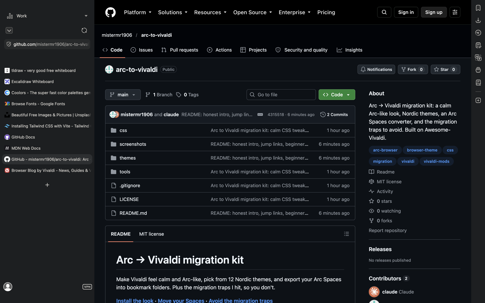
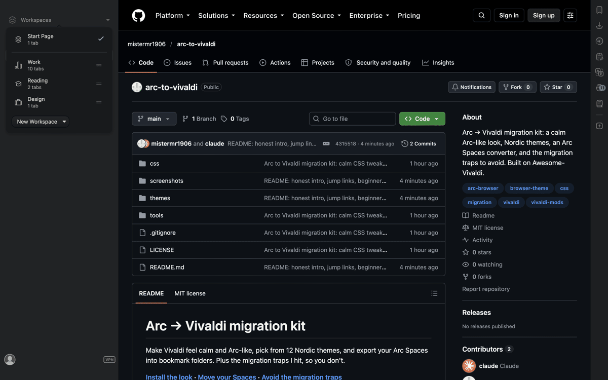
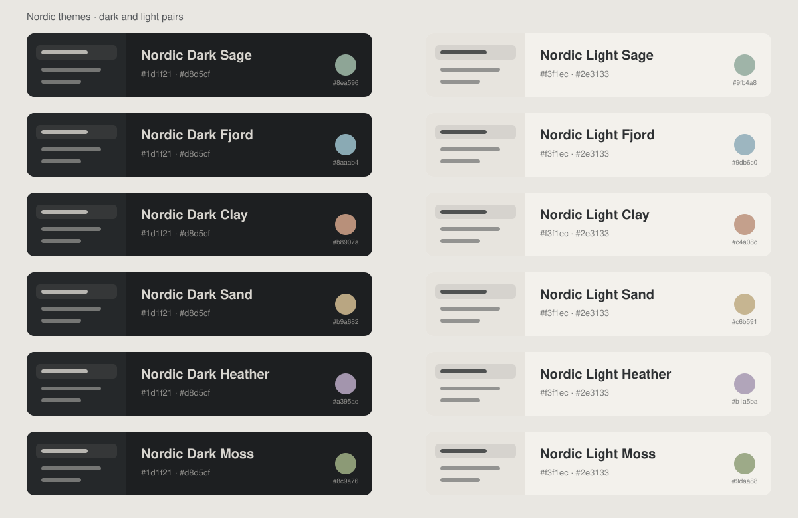

# Arc → Vivaldi migration kit

> **Arc shuts down on 22 December 2026.** After that you can't sign in to your Arc account, and its data is deleted. The Browser Company's own path is Dia. If you'd rather keep a sidebar browser that isn't built around AI, this kit gets you to Vivaldi.

Make Vivaldi feel calm and Arc-like, pick from 12 Nordic themes, and export your Arc Spaces into bookmark folders. Plus the migration traps I hit, so you don't.

**[Install the look](#install-the-look-about-15-minutes) · [Move your Spaces](#move-your-spaces) · [Avoid the migration traps](#migration-traps)**

Tested on **Vivaldi 8.2, macOS** (October 2026). Windows and Linux are untested; shortcuts and paths below are Mac ones.



_Vivaldi on macOS, using this kit (Nordic Dark Fjord theme)._



> **Before you start:** do the move **before 22 December**, while Arc still works. Keep Arc installed until you've checked everything in Vivaldi. Nothing in this kit changes or deletes anything in Arc.

## What's in it

| | What it does |
|---|---|
| `css/` | Twelve small style tweaks. Each one works on its own, so take only what you like |
| `themes/` | 12 Nordic themes: six muted accents (Sage, Fjord, Clay, Sand, Heather, Moss), each in a dark and a light version |
| `tools/arc_to_bookmarks.py` | Reads your Arc Spaces and writes one bookmarks file (one folder per Space) that Vivaldi can import |



It builds on [**Awesome-Vivaldi**](https://github.com/PaRr0tBoY/Awesome-Vivaldi) by PaRr0tBoY. I started from that pack and added these tweaks on top. Go give it a star.

## What moves over from Arc, and what doesn't

| Arc | In Vivaldi |
|---|---|
| Passwords, history, extensions (main profile) | ✅ Vivaldi's built-in Arc import |
| Passwords from your *other* Arc profiles | ⚠️ The importer fails on these. See [Traps](#migration-traps) |
| Spaces and their folders | ⚠️ Not imported. The converter turns them into **bookmark folders**; you rebuild Workspaces and tab stacks by hand (about a minute per Space) |
| Favorites (the icon grid) | ⚠️ Become a bookmarks folder. Web Panels are a good home for the 4-6 you use most |
| Logins (cookies) | ❌ You sign in again once per site |
| Extensions you built yourself | ❌ Load them again with **Load unpacked** |
| Extension settings and keys | ❌ Don't carry over; enter them again |
| Boosts, Little Arc, Space colours | ❌ No equivalent |

## Install the look (about 15 minutes)

### 1. Download this kit

Click the green **Code** button at the top of this page → **Download ZIP**. Double-click the ZIP in your Downloads folder to unzip it. You'll get a folder called `arc-to-vivaldi-main`.

### 2. Make a folder for your style files

Create a new folder, for example `Documents/vivaldi-css`. Vivaldi reads every `.css` file in it.

### 3. Pick your tweaks

Copy the files you want from `arc-to-vivaldi-main/css/` into `vivaldi-css`:

| File | What it does | Needs Awesome-Vivaldi? |
|---|---|---|
| `calm-tabs.css` | No coloured fill or glow on tabs; the active tab gets a faint grey tint, like Linear | No |
| `calm-stacks.css` | No outlines around tab stacks; the number on the right still marks a stack | No |
| `calm-address-bar.css` | Quieter suggestion list; the address field grows in place when you click it | No |
| `calm-top-area.css` | Above the tabs: just the Workspace name and the address field. Extension icons, back and reload fade in on hover | No |
| `calm-titlebar-macos.css` | *macOS, experimental.* Removes the full-width title strip; only the window buttons stay, in the corner | No |
| `calm-folded-column.css` | Clean centred icons when the tab column folds | Yes: works with PeekTabbar |
| `calm-peek-tabbar-override.css` | Tunes the slide-out tab bar: stack names stay readable, faster slide | Yes: needs PeekTabbar |
| `calm-polish.css` | Apple-style finish: small grey workspace label, one title size, quiet tab counts, titles fade instead of cutting off, even spacing, no bounce when the sidebar slides in | No |
| `calm-wide-stacks.css` | Sidebar widens to 420px when a stack's second column opens, so names fit; icons stay in exactly the same spot when the column folds | Yes: needs PeekTabbar |
| `calm-quick-commands.css` | Quick Commands made solid and quiet: no see-through panel, a grey pill for the selected row, one left edge, no animation | No |
| `calm-split-view.css` | Split view: a 1px neutral hairline around the active page instead of the thick coloured frame | No |
| `no-nav-buttons.css` | Removes Back, Forward and Reload from the sidebar, for people who use ⌘[ ⌘] ⌘R | No |

### 4. Optional: add the Awesome-Vivaldi base (for the slide-out tab bar)

Download [Awesome-Vivaldi](https://github.com/PaRr0tBoY/Awesome-Vivaldi) the same way (Code → Download ZIP), open `Vivaldi8.0Stable/CSS/`, and copy these into `vivaldi-css` too:
`PeekTabbar.css`, `AdaptiveBF.css`, `BetterAnimation.css`, `RemoveClutter.css`, `Quietify.css`, `VividQC.css`, `DownloadPanel.css`, `Extensions.css`, `LineBreak.css`.

Use only these style files: the pack's script mods don't load on Vivaldi 8.2.

### 5. Switch it on

1. Open `vivaldi://experiments`, turn on **Allow CSS modifications**, restart Vivaldi.
2. Settings → Appearance → **Custom UI Modifications** → **Select Folder** → pick `vivaldi-css`.
3. Settings → Themes → **Import Theme…** → pick a dark and a light theme from `arc-to-vivaldi-main/themes/`. Then set **Theme Schedule → Operating System** to that pair.
4. Change the settings in the checklist below, then restart Vivaldi.

**Undo any tweak:** delete its file from `vivaldi-css` and restart Vivaldi.

### Settings checklist

Vivaldi can't save these into a file, so set them by hand:

- **Tabs** → Tab Bar Position: **Left** · Tab Stacking: **Two-Level** · New Tab Position: **As Last Tab**
- **Tabs** → Tab Stack Options: **Open Tabs in Current Tab Stack** off
- **Tabs** → Pinned Tabs: **Don't Close Pinned Tabs**, and **Allow Closing in Pinned Stacks** off (see Traps)
- **Tabs** → Tab Options: **Show Popup Thumbnails** off, **Show Tab Thumbnails** off
- **Appearance** → UI Auto-hide: on, with Tab Bar, Panel and Bookmarks Bar ticked · Status Bar: **Status Info Overlay**
- **General** → Startup: **Last Session**, **Lazy Load Restored Tabs** on (tabs load when you click them, like Arc)
- **Keyboard** → give **⌘T** to Quick Commands (clear it from New Tab first): Arc's "type first, tab later" box
- **Keyboard** → give **⌘S** to Tab Bar (clear it from Save Page As first): shows and hides the sidebar, like Arc
- **Quick Commands** → **Open Links in New Tab** on
- **Search** → add YouTube with nickname `yt` and URL `https://www.youtube.com/results?search_query=%s`. Then `⌘T` → `yt lofi` works like Arc's tab-to-search

## Move your Spaces

The converter **reads** Arc's sidebar file and **writes** one bookmarks file. It doesn't change anything in Arc. It needs Python 3, which comes with most Macs; if Terminal says `python3: command not found`, install it from [python.org](https://www.python.org/downloads/).

1. Open **Terminal** (⌘Space, type Terminal).
2. Paste this and press Enter (it assumes the kit is unzipped in Downloads):
   ```bash
   python3 ~/Downloads/arc-to-vivaldi-main/tools/arc_to_bookmarks.py ~/Desktop/arc-spaces.html
   ```
   It prints how many links each Space has, and saves `arc-spaces.html` on your Desktop.
3. Vivaldi → File → **Import from Applications or Bookmark Files** → **Bookmarks HTML File** → pick `arc-spaces.html`.
4. For each Space, create a **Workspace** with the same name.
5. In that Workspace, right-click a folder in **Bookmarks → Imported → Arc Spaces** → **Open in New Tab**. Vivaldi only opens links directly inside the folder you click, so open each sub-folder separately.
6. Select the tabs (click the first, shift-click the last) → right-click → **Stack Tabs** → right-click the stack → **Rename**. Now it behaves like an Arc folder.
7. Right-click the stack → **Pin Tab Stack** so it stays put.

## Migration traps

**⌘W can delete your pinned tabs.** In Arc, ⌘W on a pinned tab just put it away. In Vivaldi, with "Allow Closing in Pinned Stacks" on, ⌘W removes tabs from your stacks for good. Keep it **off**. If it already happened, press **⇧⌘T** repeatedly to bring tabs back.

**Passwords from other Arc profiles.** The Arc importer handles your main profile only; picking another profile fails with "Login Data file not found". What works: in Arc, switch to a Space that uses that profile, open `arc://password-manager/settings`, **Download file**, then in Vivaldi open `vivaldi://password-manager/settings` → **Import**.
> ⚠️ **That file holds all your passwords in plain text.** Delete it, and empty the Bin, as soon as the import is done.

**New tabs come out pinned.** A tab you open while you're inside a pinned stack inherits the pin. No setting changes this; it's how Vivaldi works. Right-click → unpin, or open new tabs from a normal tab.

**Tabs open inside your stacks.** Turn off **Open Tabs in Current Tab Stack** and set **New Tab Position** to **As Last Tab**.

**Every tab reloads on start.** Turn on **Lazy Load Restored Tabs** (General → Startup).

**SharePoint and OneDrive links turn into "Home - OneDrive".** If you open them before signing in, Microsoft redirects them and the real address is lost. Sign in once, then reopen them from the imported bookmarks.

**Your own extensions.** `vivaldi://extensions` → **Developer mode** → **Load unpacked**. Their saved settings and keys stay in Arc, so enter them again. Shortcuts live under `vivaldi://extensions` → ☰ → **Keyboard shortcuts**.

**Netflix works**, but at a lower maximum resolution than in Safari, which is true of any Chrome-based browser on a Mac.

## Credits and licence

- Built on [Awesome-Vivaldi](https://github.com/PaRr0tBoY/Awesome-Vivaldi) by PaRr0tBoY (GPL-3.0). Its files aren't included here; download them from the original repo.
- The tweaks, themes and script in this repo are MIT-licensed. See [LICENSE](LICENSE).

If something breaks after a Vivaldi update, open an issue and say which Vivaldi version you're on.
